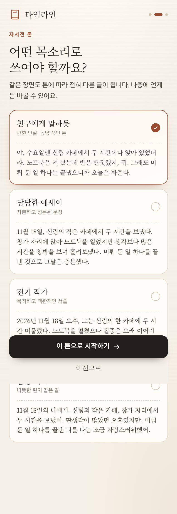
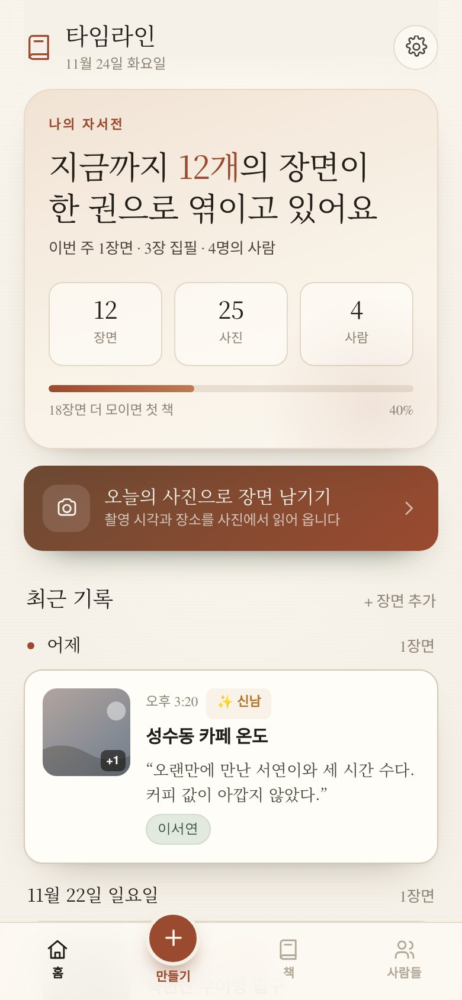
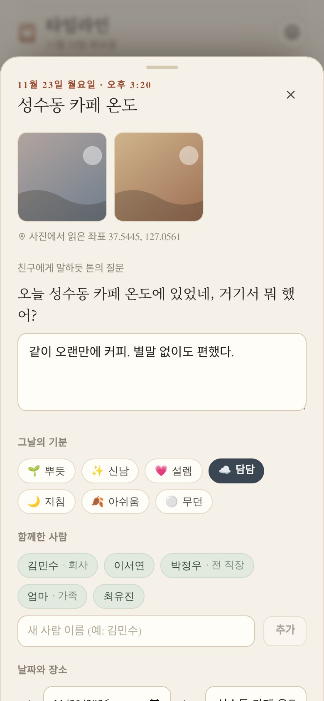
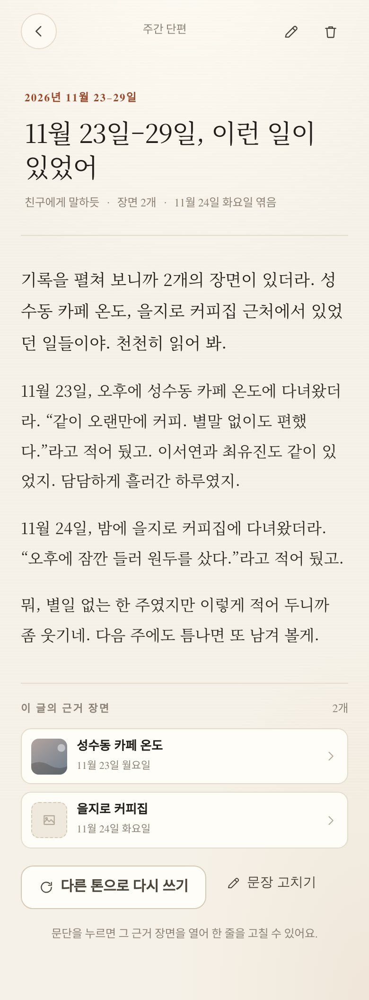
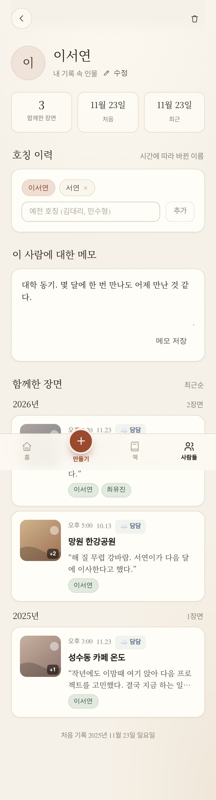
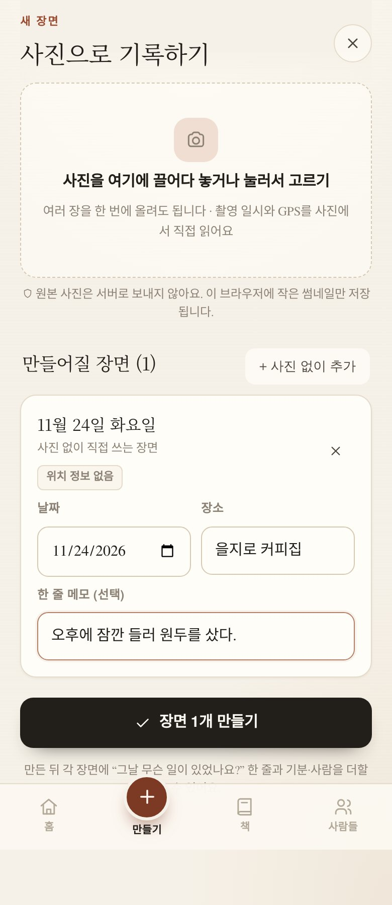

# 타임라인 (Timeline) — 무료 웹 MVP

> 매일 쓰지 않아도 쌓이는 자서전.
> 사진 한 장과 한 줄의 답으로 장면을 만들고, 고른 톤으로 한 편의 글로 엮습니다.

**라이브 데모 — <https://bmws-g.github.io/timeline-web/>** (GitHub Pages, `gh-pages` 브랜치가 `dist/`를 서빙)

Vue 3 + Vite + TypeScript로 만든 **설치 없이 바로 열리는 웹 앱(PWA)** 입니다. 서버도, 데이터베이스도, API 키도 없이 첫 화면부터 끝까지 동작하며, Vercel·Cloudflare Pages에 그대로 올릴 수 있습니다. 원하면 설정에서 Gemini 키를 넣어 실제 AI 문장으로 바꿀 수 있고, `docs/timeline-mvp-schema.sql`의 Supabase 스키마로 확장할 수 있습니다.

| 온보딩 · 톤 선택 | 홈 · 책 진행감 | 장면 · 1줄 인터뷰 |
| --- | --- | --- |
|  |  |  |

| 챕터 리더 | 사람별 타임라인 | 새 장면(사진) |
| --- | --- | --- |
|  |  |  |

---

## 1. 바로 실행하기

```bash
cd timeline-web
npm install
npm run dev        # http://localhost:5173
npm run build      # dist/ 정적 파일 생성 (타입 검사 포함)
npm run preview    # 빌드 결과 미리보기
```

- Node 18 이상(권장 20 LTS)에서 동작합니다.
- `npm run build`는 `vue-tsc --noEmit`로 타입을 먼저 검사합니다. 타입 오류가 있으면 빌드가 멈춥니다.
- 첫 실행 시 온보딩에서 톤을 고르고 **“샘플 기록으로 시작하기”** 를 켜 두면, 지난 3주의 장면 12개와 챕터 3편이 채워져 앱 전체를 바로 둘러볼 수 있습니다.

## 2. 구현된 다섯 가지 흐름

| # | 흐름 | 화면 | 동작 |
| --- | --- | --- | --- |
| 1 | **온보딩 · 톤 선택** | `#/welcome` | 4가지 톤(친구에게 말하듯 / 담담한 에세이 / 전기 작가 / 감성 기록)을 같은 장면의 예시 문장과 함께 비교하고 선택, 인터뷰 시간 설정 |
| 2 | **사진 → 장면 자동 생성** | `#/add` | 사진 여러 장을 올리면 `exifr`로 촬영 일시·GPS를 읽어 **날짜별 장면 초안**을 자동 생성. EXIF가 없어도 날짜·장소를 직접 보완 가능, 좌표로 장소명 찾기(OpenStreetMap) 지원 |
| 3 | **1줄 인터뷰 · 기분 · 인물** | 장면 시트 | 선택한 톤의 말투로 “그날 무슨 일이 있었나요?” 질문, 한 줄 답변 + 기분 7종 + 사람 태그. 건너뛰어도 사진·시간으로 페이지가 채워짐 |
| 4 | **자서전 챕터 리더** | `#/book`, `#/book/:id` | 기간(이번 주·지난주·이번 달)의 장면을 선택한 톤으로 한 편으로 엮음. 문단마다 근거 장면이 연결되고, 문단을 누르면 그 장면을 바로 수정. 톤을 바꿔 다시 쓰면 새 버전이 쌓임 |
| 5 | **인물별 타임라인** | `#/people`, `#/people/:id` | 사람별 함께한 장면 수·최근 만남, 호칭 이력(별칭), 메모, 연도별 장면 모아보기 |

부가 기능: 책 진행감(장면 30개 = 첫 책), ‘1년 전 오늘’, JSON 백업/복원, 샘플 데이터 켜고 끄기, 오프라인 캐시(서비스 워커), 홈 화면 설치(PWA).

## 3. AI 문장 (선택)

키가 없으면 **로컬 문장 조합기**가 즉시 글을 씁니다. 선택한 톤의 문장 틀에 장면의 사실(날짜·시간·장소·한 줄 답변·기분·사람)만 채워 넣는 방식이라, 없는 사실을 만들지 않고 네트워크 없이도 동작합니다.

실제 AI 문장을 원하면 **설정 → AI 문장**에서 Gemini API 키를 넣고 스위치를 켜세요.

- 모델: `gemini-2.5-flash` (`src/lib/gemini.ts`)
- 키는 `localStorage`에만 저장되고 요청은 브라우저에서 Google로 직접 갑니다. 실패하면 자동으로 로컬 문장으로 돌아가고 토스트로 알려 줍니다.
- 무료 키: <https://aistudio.google.com/apikey>
- **배포용 권장안**: 브라우저에 키를 두는 대신 서버 함수(Cloudflare Pages Functions, Vercel Serverless, Supabase Edge Function)에서 호출하고 앱은 그 엔드포인트만 부르게 바꾸세요. `src/lib/gemini.ts`의 `requestGeminiChapter()` 한 곳만 교체하면 됩니다.

## 4. 무료 배포

빌드 결과는 완전한 정적 파일이고, 라우터는 **해시 히스토리**(`/#/book`)를 쓰므로 리라이트 설정이 필요 없습니다. `vite.config.ts`의 `base: './'` 덕분에 하위 경로에 올려도 동작합니다.

### Vercel

1. 이 폴더를 GitHub에 올립니다.
2. Vercel → **Add New Project** → 저장소 선택.
3. Framework Preset **Vite**, Build Command `npm run build`, Output Directory `dist` (자동 인식됩니다).
4. Deploy. 이후 푸시마다 자동 배포됩니다.

CLI로 하려면:

```bash
npm i -g vercel
vercel --prod
```

### Cloudflare Pages

1. Cloudflare Dashboard → **Workers & Pages** → **Create** → **Pages** → **Connect to Git**.
2. Build command `npm run build`, Build output directory `dist`.
3. (선택) 환경 변수에 `NODE_VERSION=20`.
4. Save and Deploy.

정적 업로드만 하려면 `npx wrangler pages deploy dist --project-name timeline-web`.

### GitHub Pages

```bash
npm run build
npx gh-pages -d dist       # 또는 dist를 gh-pages 브랜치에 푸시
```

`base: './'` + 해시 라우터라 `https://<user>.github.io/<repo>/` 하위 경로에서도 그대로 열립니다.

### 아이폰 홈 화면에 설치

Safari로 배포 주소를 연 뒤 **공유 → 홈 화면에 추가**. `manifest.webmanifest`와 아이콘, `apple-mobile-web-app-*` 메타가 준비되어 있어 앱처럼 전체 화면으로 열립니다. 한 번 열면 서비스 워커가 셸을 캐시해 오프라인에서도 기록을 볼 수 있습니다.

## 5. 데이터는 어디에 저장되나

- 서버가 없습니다. 모든 기록은 브라우저 `localStorage`의 `timeline.state.v1` 키에 JSON으로 저장됩니다.
- 사진 원본은 **업로드되지 않습니다.** 브라우저에서 최대 560px 썸네일(JPEG)로 줄여 장면에 담고, EXIF의 촬영 시각·좌표만 함께 보관합니다.
- 저장 공간이 가득 차면 설정 화면에 경고가 뜹니다. **설정 → JSON으로 내보내기**로 백업하고 샘플 기록을 지우면 됩니다.
- 같은 브라우저·같은 주소에서만 유지됩니다. 기기를 바꾸려면 내보내기 → 새 기기에서 불러오기.

### 스키마와의 대응

`docs/timeline-mvp-schema.sql`의 테이블과 앱 타입은 다음처럼 맞춰 두었습니다 (`src/types.ts`).

| 앱 타입 | Supabase 테이블 | 비고 |
| --- | --- | --- |
| `Scene` | `events` | `eventDate`, `startedAt`, `locationName`, `lat/lng`, `autoSummary`, `userNote`, `mood`, `interviewState`, `sourceType` |
| `Person` | `persons` + `person_aliases` | `displayName`, `disambiguator`, `aliases[]`, `note` |
| `Scene.personIds` | `event_persons` | 장면–인물 N:M (앱에서는 id 배열로 단순화) |
| `Chapter` | `chapters` | `kind`, `periodStart/End`, `toneKey`(`style_profile_id`), `bodyMd`, `eventIds`, `version`, `generatedBy`(`model`) |

## 6. Supabase로 확장하기

1. Supabase 프로젝트를 만들고 SQL Editor에서 `docs/timeline-mvp-schema.sql`을 실행합니다. (`pgcrypto`, `pg_trgm`, `btree_gist` 확장과 RLS 정책이 함께 들어 있습니다.)
2. Authentication에서 이메일 또는 Apple 로그인을 켭니다.
3. `.env.example`을 `.env.local`로 복사하고 값을 채웁니다.

```bash
VITE_SUPABASE_URL=https://xxxx.supabase.co
VITE_SUPABASE_ANON_KEY=eyJhbGciOi...
```

4. `npm i @supabase/supabase-js` 후 클라이언트를 하나 만듭니다.

```ts
// src/lib/supabase.ts
import { createClient } from '@supabase/supabase-js'
export const supabase = createClient(
  import.meta.env.VITE_SUPABASE_URL,
  import.meta.env.VITE_SUPABASE_ANON_KEY,
)
```

5. `src/store.ts`의 액션을 API 호출로 바꿔 끼웁니다. 예를 들어 장면 저장(`addScenes`)은 다음처럼 매핑됩니다.

```ts
await supabase.from('events').upsert(
  scenes.map((s) => ({
    user_id: user.id,
    event_date: s.eventDate,
    started_at: s.startedAt,
    title: s.title,
    location_name: s.locationName,
    lat: s.lat,
    lng: s.lng,
    auto_summary: s.autoSummary,
    user_note: s.userNote,
    mood_tag: s.mood,
    source_type: s.sourceType,
    source_ref: s.photos[0]?.name ?? null, // 중복 수집 방지 키
    interview_state: s.interviewState,
  })),
  { onConflict: 'user_id,source_type,source_ref' },
)
```

6. 썸네일은 Supabase Storage의 **비공개 버킷**에 올리고 signed URL로 읽습니다. 원본 사진은 올리지 않는 현재 방침을 유지하는 편을 권합니다.
7. AI 문장은 Edge Function에서 호출해 `GEMINI_API_KEY`를 서버에만 두세요. `chapters`에는 `model`, `prompt_version`, `style_profile_id`를 함께 남기면 나중에 “예전 톤으로 다시 읽기”가 가능합니다.

## 7. 폴더 구조

```
timeline-web/
├─ index.html
├─ public/
│  ├─ icon.svg · icon-192.png · icon-512.png
│  ├─ manifest.webmanifest        # PWA
│  └─ sw.js                       # 오프라인 셸 캐시
├─ src/
│  ├─ main.ts · App.vue · router.ts · style.css
│  ├─ types.ts                    # events/persons/chapters 대응 타입
│  ├─ store.ts                    # localStorage 영속화 + 모든 액션
│  ├─ data/
│  │  ├─ tones.ts                 # 4가지 톤 프리셋(예시 문장·질문 말투·프롬프트)
│  │  └─ demo.ts                  # 상대 날짜로 만드는 샘플 기록 12장면
│  ├─ lib/
│  │  ├─ date.ts                  # 한국어 날짜·주/월 범위
│  │  ├─ photos.ts                # exifr EXIF 파싱 + 캔버스 썸네일
│  │  ├─ scene.ts                 # 사진 → 장면 초안 그룹화
│  │  ├─ narrative.ts             # 톤별 로컬 문장 조합기
│  │  ├─ gemini.ts                # 선택적 AI 호출
│  │  └─ id.ts
│  ├─ components/                 # SceneCard, SceneSheet, BookCard, Icon, TabBar …
│  └─ views/                      # Onboarding, Home, Capture, Chapters, Reader, People, Person, Settings
├─ preview/                       # 실제 화면 캡처
├─ .env.example
└─ README.md
```

## 8. 알려진 한계와 다음 단계

- **알림은 없습니다.** 웹 푸시는 서버와 구독 저장이 필요합니다. 지금은 정해 둔 인터뷰 시간과 무관하게, 앱을 열면 홈에 “한 줄을 기다리는 장면” 카드가 뜹니다.
- **위치 자동 수집은 없습니다.** 웹 브라우저에서는 백그라운드 방문 감지가 불가능해 사진 EXIF의 좌표를 씁니다. 네이티브 앱(Expo)으로 옮길 때 `expo-location` 지오펜싱을 붙이면 됩니다.
- **장소명은 직접 입력 또는 OpenStreetMap 조회**입니다. 조회는 좌표를 OSM에 보내므로 버튼을 누를 때만 실행됩니다.
- **썸네일 저장 용량**: 사진이 수백 장 쌓이면 localStorage 한도(약 5MB)에 닿습니다. 다음 단계로 IndexedDB(`idb`)로 옮기면 훨씬 넉넉해집니다.
- **여러 기기 동기화**: 6번의 Supabase 연결이 그 답입니다. 스키마에 RLS와 `event_persons` 소유자 검증 트리거가 이미 들어 있습니다.

---

### 참고 문서

- `docs/timeline-app.md` — 앱 아이디어 노트
- `docs/timeline-mvp-spec.md` — 데이터 모델·화면·배치 설계
- `docs/timeline-mvp-schema.sql` — PostgreSQL DDL 전문
